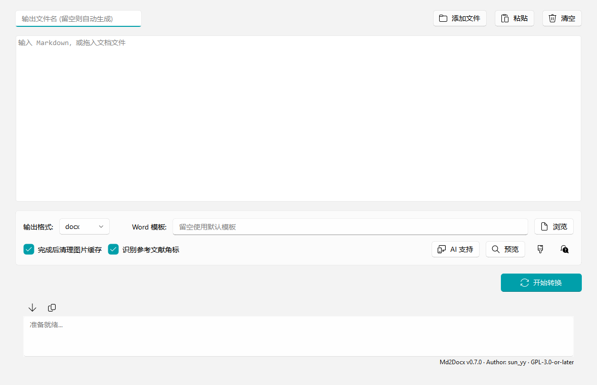
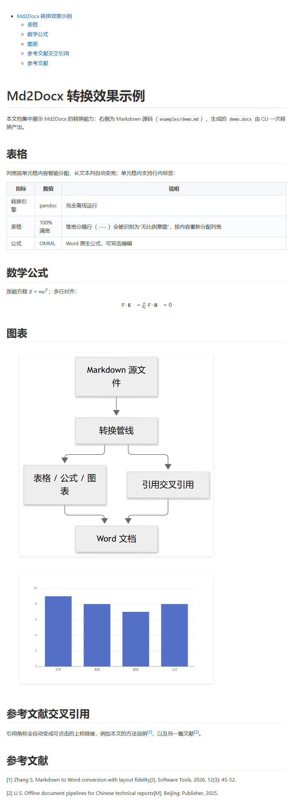

# Md2Docx — Markdown 转 Word/HTML 转换器

[](LICENSE)
[]()
[](https://www.python.org/)
[](CHANGELOG.md)
[](https://github.com/sun-6/Md2Docx/actions/workflows/ci.yml)
[](https://github.com/sun-6/Md2Docx/stargazers)

**把 Markdown 变成排版精良的 Word 文档——完全离线，中文友好，为 AI 与脚本场景内置结构化 CLI。**

不依赖在线服务、不需要配置环境：表格智能列宽、原生公式、图表渲染、参考文献交叉引用，开箱即得。也支持 Word 反向提取为 Markdown。



[English](README.en.md) · 产品定位详见 [docs/POSITIONING.md](docs/POSITIONING.md)

## 转换效果

左：Markdown 源码（[examples/demo.md](examples/demo.md)）；右：一次转换的输出（[examples/demo.docx](examples/demo.docx) 下载即验）。
下图为转换输出的浏览器预览截图——智能列宽表格、原生公式、mermaid 流程图、数据图表、可点击的参考文献交叉引用（[1] 角标跳转到文末条目）：



## 为什么不直接用 Pandoc？

Pandoc 是本项目的转换内核，但"直接调 Pandoc"得到的 Word 与排版精良之间隔着大量工程细节：

| 需求 | 直接用 Pandoc | Md2Docx |
|---|---|---|
| 表格满宽排版 | 窄源码行输出 autofit 窄表 | 列宽按单元格内容分配，全部表格撑满正文区 |
| 单元格内 HTML（`<br>`/`<b>`/``） | 静默丢弃 | 全部保留，转原生元素 |
| Mermaid / ECharts 图表 | 不支持，需自建渲染管线 | 离线渲染为高清 PNG，内容哈希缓存，二次转换秒级 |
| 参考文献引用 | 角标是纯文本 | 自动变上标交叉引用，Ctrl+点击跳转条目 |
| 中文排版 | 默认模板字体混乱 | 黑体/宋体/Times New Roman 主题字体体系 |
| 转换质量 | 静默丢内容不自知 | `lint` 预检 + `--verify` 结构校验 + fuzz 回归 |

同时保留了 Pandoc 的全部表达力：LaTeX 公式转 Word 原生 OMML、合并单元格、front matter 配置、`pandoc_args` 透传。

## 功能特点

- 🔄 **转换**：md → docx / html / pdf（pandoc → typst，完全离线）
- 🧮 **公式**：`$...$` / `$$...$$` → Word 原生 OMML / 浏览器 MathML；分数、矩阵、分段函数、多行对齐、公式内中文均已验证无损
- 📊 **图表**：Mermaid（v12 引擎，标签自动换行、直角连线、缺省黑白配色）与 ECharts 数据图表，离线渲染为 3x 高清 PNG；支持 `{theme/width/alt}` 围栏参数
- 🔗 **引用交叉引用**：`[1]`/`[2,3]`/`[1-3]` 角标自动变上标超链接，指向 `## 参考文献` 编号条目
- ↩️ **反向提取**：docx/html → markdown + 媒体，编辑后可无损转回
- 🩺 **体检**：`lint` 转换前按行号报告问题，`--deep` 浏览器级 mermaid 语法校验，`--verify` 输出结构一致性校验
- ⚙️ **批量与自动化**：目录批量、stdin 管道、`--json` 结构化输出、退出码契约（0/1/2）
- 📝 **文档自带配置**：front matter `md2docx:` 段声明目录、模板、引用开关、pandoc 参数

## 表达能力（写 Markdown 时的建议）

**文档由 AI 撰写时，最好让它安装并使用 [md2docx 技能包](skill/md2docx/SKILL.md)来写**，而不是自由发挥完再拿去转换：技能内置整套撰写规范——front matter 配置、图表/公式围栏、题注、角标引用、目录与分页约定——从源头产出的 md 与转换格式完全契合，转换零降级。GUI 点"AI 支持"一键安装后，对 AI 说"用 md2docx 技能写一份××报告"即可。

人工手写时的速查：

| 内容需求 | 推荐 | 避免 |
|---|---|---|
| 流程/时序/架构图 | ```mermaid 围栏（中文标签可用） | ASCII 字符画 |
| 数学表达 | LaTeX（多行对齐用 `aligned`） | "x 的平方"式文字 |
| 合并单元格 | 原生 `<table>` + `colspan` | 拆行（管道表格不支持合并） |
| 单元格内换行/强调 | `<br>`、`<b>` 行内标签 | `<div>`/`<p>`（会被解包） |
| 参考文献引用 | 正文角标 `[1]`/`[2,3]` + `## 参考文献` 编号条目 | `<sup>` 包裹、手写 `<a>` 链接 |

公式编号 `\tag{X}` 会自动改写为可见文本；引用交叉引用可经 GUI 选项 / CLI `--no-citations` / front matter `citations: false` 关闭。

## 获取

- **打包版（推荐）**：从 [GitHub Releases](../../releases) 下载 `Md2Docx_Release_Dir_*.zip`（单目录版：`Md2Docx_Pro.exe` + `md2docx-cli.exe` 双程序 + Agent 技能包）。解压即用，无需安装任何依赖，pandoc / 浏览器内核 / 图表引擎全部离线内置
- **从源码运行**：见下文[开发](#开发)

## 使用方式

### GUI（普通用户）

运行 `Md2Docx_Pro.exe`，拖入文件即可批量处理——**方向自动识别**：拖入 `.md` 转 Word/HTML，拖入 `.docx`/`.html` 提取为 Markdown（图片落 `media/` 目录）。转换前自动做无感体检，问题按行号显示在日志区。

### 命令行（脚本 / AI Agent）

```bash
md2docx-cli convert 方案.md --json                     # 转 Word（结果 JSON）
md2docx-cli convert 方案.md --format pdf --json        # 转 PDF（离线）
md2docx-cli convert 方案.md --dry-run --json           # 只体检不产出
md2docx-cli lint 方案.md --json                        # 可转换性体检（行号+严重度）
md2docx-cli extract 报告.docx -o work/报告.md --json   # Word 反向提取为 markdown
md2docx-cli render-mermaid 图.mmd -o 图.png --json     # 独立渲染 mermaid
md2docx-cli convert <目录> -o <输出目录> --json        # 批量转换
md2docx-cli check --json                               # 环境自检
```

约定：stdout 只输出结果（`--json` 时为单个 JSON 对象），日志走 stderr；退出码 0 成功 / 1 失败 / 2 用法错误。完整命令参考、JSON schema、错误码表见 `skill/md2docx/reference.md`。

### 给 AI 启用（一键）

GUI 点击 **"AI 支持"** 按钮：注册 PATH → 安装 Agent 技能包 → 环境自检。技能包含两部分：**操作规范**（调 CLI、解读 JSON 结果、按 remediation 修复）与**撰写规范**（front matter、图表/公式围栏、题注、角标引用、目录与分页约定）。之后对 Claude Code / Cursor / Zcode 等 Agent 说"把这份 md 转成 Word"即可；**更推荐的用法是让 AI 按该技能从零撰写文档**——产出的 md 天然契合转换格式，一次转换零降级。

## 常见问题

**转换时报 `WinError 32`（文件被占用）？**
输出的 docx 正被 Word/WPS 打开。关闭该文档后重新转换即可。

**目录页码什么时候生成？**
转换时已写入 OOXML 标准的 `updateFields` 标记：用 **Word** 打开文档即自动重算全部域、生成带页码目录（个别版本可能弹一次更新确认，点"是"即可）。**WPS 出于安全策略默认不响应该标记**——它的域更新依赖用户手动操作（如 F9）或打印时的特定设置，而非文档级标记：打开后按 Ctrl+A → F9 刷新一次目录即生成。

**图表想要彩色而不是黑白？**
缺省黑白（neutral）适合正式报告；需要彩色时在围栏参数里指定：```` ```mermaid {theme=default} ````，或独立渲染时加 `--theme default`。

**Word/WPS 里代码字体显示异常？**
代码字体为 Consolas（Windows 自带）。若用了自定义模板，请勿把代码样式指向小众字体——缺字体的机器上回退渲染会乱码。

**为什么许可证是 GPL-3.0？**
GUI 组件依赖决定，详见下文[开源许可](#开源许可)。

## 开发

```bash
uv sync
uv run python Md2Docx.py              # GUI
uv run python md2docx_cli.py --help   # CLI
uv run python build_package.py        # 打包（onedir 双 exe + onefile）
```

仓库布局：`md2docx_core.py`（核心逻辑）/ `md2docx_cli.py`（CLI）/ `Md2Docx.py`（GUI）/ `table_filter.lua`（pandoc 过滤器）/ `skill/md2docx/`（Agent 技能包）。改动后的验证命令清单见 `AGENTS.md`。

## 系统要求

- 打包版：Windows 10+，无其他依赖
- 开发：Python 3.12+、PySide6、playwright（`playwright install chromium`）

## 社区与支持

- 问题反馈与功能建议：[Issue 区](../../issues)（bug / feature 模板已备好）
- 安全漏洞：按 [SECURITY.md](SECURITY.md) 私密披露，勿开公开 issue
- 贡献代码：[CONTRIBUTING.md](CONTRIBUTING.md)（含验证命令清单与 PR 模板）

## 开源许可

**许可证：GPL-3.0-or-later**（全文见 [`LICENSE`](LICENSE)，源文件带 SPDX 标识）。这不是自由选择的结果而是依赖决定的——GUI 使用的 [PySide6-Fluent-Widgets](https://github.com/zhiyiYo/PyQt-Fluent-Widgets) 以 GPLv3 分发且随二进制发布，若需闭源商业分发须购买其商业授权或替换该组件。

### 源码与二进制

- 源码仓库：<https://github.com/sun-6/Md2Docx>（fork 后请同步更新此处与 `licenses/THIRD-PARTY-NOTICES.md` 的地址）
- 二进制以 GitHub Release 分发，每个 Release 的 zip 内含 `LICENSE`、`licenses/` 第三方声明，并对应同 tag 源码（满足 GPL-3.0 第 6 条的对应源码提供）
- 第三方组件及协议清单见 [`licenses/THIRD-PARTY-NOTICES.md`](licenses/THIRD-PARTY-NOTICES.md)

### 第三方组件（摘要）

| 组件 | 用途 | 许可证 |
|---|---|---|
| [pandoc](https://pandoc.org/) | 文档转换内核（随发布包分发） | GPL-2.0-or-later |
| [PySide6](https://www.qt.io/qt-for-python) (Qt) | GUI 框架 | LGPL-3.0 / GPL / 商业三选一 |
| [PySide6-Fluent-Widgets](https://github.com/zhiyiYo/PyQt-Fluent-Widgets) | Fluent 界面组件 | **GPL-3.0**（有商业授权） |
| [pysidesix-frameless-window](https://github.com/zhiyiYo/PySide6-Frameless-Window) | 无边框窗口 | LGPL-3.0 |
| [Playwright](https://playwright.dev/python/) | Mermaid 渲染浏览器引擎 | Apache-2.0 |
| Chromium (headless shell) | 随 Playwright 打包 | BSD-3-Clause 等 |
| [mermaid.js](https://mermaid.js.org/) v12.0.0 | 图表渲染（随发布包分发） | MIT |
| [PyInstaller](https://pyinstaller.org/) | 打包 | GPL-2.0+ 附 bootloader 例外 |
| Python 标准库 | zipfile/ctypes 等 | PSF License |
