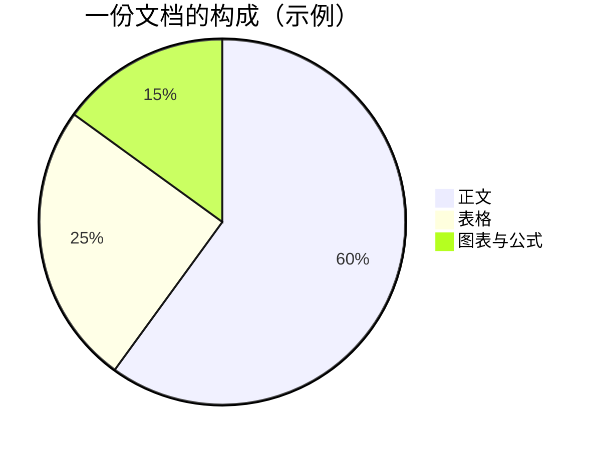

---
md2docx:
  toc: true
  toc_depth: 2
---

# 🚀 Md2Docx 快速指南

> **一句话介绍**：把 Markdown 变成排版精美的 Word 文档，也能把 Word 变回 Markdown。

💡 **这份文档本身就是演示**——下面用到的表格、公式、图表、HTML 标签，全部是
Md2Docx 支持的语法；开头的 front matter 还演示了自动生成目录的配置。
**直接把本文件拖进软件，就能看到效果。**

## 1. 它能干什么？

| 你拖入的 | 你得到的 | 说明 |
| --- | --- | --- |
| `.md` 文件 | 同名 `.docx` / `.html` / `.pdf` | 支持表格、公式、图表；格式在界面下拉里选 |
| `.docx` / `.html` 文件 | 同名 `.md` + `media/` 图片目录 | 提取为 Markdown，可编辑后转回 |

方向不用选，软件看文件类型自动判断；一次拖多个就是批量。

## 2. 怎么用？(三步)


1. 把文件拖进窗口（可一次多个）
2. 需要的话：选输出格式、指定 Word 模板
3. 点「开始转换」，完成后自动打开

转换前软件会**自动体检**，发现图片缺失、语法错误等问题时，会在下方日志区
按行号提示，但不打断转换。

## 3. 写 Markdown 时可以多"讲究"一点

### 表格：单元格里能用 HTML

| 写法 | 效果 | 典型用途 |
| --- | --- | --- |
| `<b>加粗</b>` | <b>加粗</b> | 强调关键数字 |
| `<br>` | 第一行<br>第二行 | 一个格子写两行 |
| `<del>旧价格</del>` | <del>旧价格</del> | 划掉过期信息 |
| `<span style="color:red">红字</span>` | <span style="color:red">红字</span> | 彩色标注 |
| `[链接](https://example.com)` | [链接](https://example.com) | 附参考资料 |

### 合并单元格：用原生 HTML 表格

管道表格不支持合并，需要时直接写 HTML 表格：

<table>
<tr><th>费用项</th><th>金额</th></tr>
<tr><td>硬件采购</td><td>8 万</td></tr>
<tr><td>软件开发</td><td>12 万</td></tr>
<tr><td colspan="2"><b>合计：20 万</b>（本行演示合并单元格）</td></tr>
</table>

### 公式：直接写 LaTeX

行内公式 $E = mc^2$ 随文出现；块级公式独立成行：

$$f(x) = \begin{cases} 1 & x > 0 \\ 0 & x \le 0 \end{cases} \qquad M = \begin{pmatrix} a & b \\ c & d \end{pmatrix}$$

矩阵、分段函数、分数、上下标、多行对齐（`aligned`/`align`）都会转成 Word
原生公式（可双击编辑）。遇到不认识的宏会退化为纯文本，转换后加 `--verify`
即可查出。

### 数据图表：写 chart 围栏

有数据要画成柱状图/折线图/饼图时，直接写 JSON（无需画图工具）：

```chart
{"type": "bar", "title": "季度营收（万元）", "x": ["Q1", "Q2", "Q3", "Q4"],
 "series": [{"name": "2026", "data": [120, 200, 150, 180]}]}
```

### 图表：写 mermaid，自动变图片



流程图、时序图、甘特图、饼图、类图、状态图都支持，中文标签直接可用，
无需安装任何画图工具。

## 4. 给 AI / 脚本用（命令行）

界面上的「AI 支持」按钮一键开通后，就能这样用：

```bash
md2docx-cli convert 方案.md --json          # 转 Word，结果为 JSON
md2docx-cli extract 报告.docx -o work/报告.md  # Word 提取为 Markdown
md2docx-cli lint 方案.md --json             # 转换前体检
```

对 Claude Code / Cursor 等 AI 说"把这份 md 转成 Word"即可，详见
`skill/md2docx/`。

## 5. 常见问题

| 问题 | 答案 |
| --- | --- |
| 提示"Windows 已保护你的电脑"？ | 点「更多信息」→「仍要运行」。软件未做商业签名，这是正常提示 |
| 安装包为什么约 250MB？ | 内置了 Pandoc、浏览器引擎与图表库，换取**完全离线**可用 |
| 首次转换图表有点慢？ | 首次渲染数秒，之后有缓存，二次转换秒级完成 |
| 能不能删 `.md2docx_images` 文件夹？ | 不建议——删了图表会重新渲染变慢；点「完成后清理」可以有意识地清 |
| Word 打开目录页码是空的？ | 目录页右键 →「更新域」→「更新整个目录」 |

---

*更多细节见同目录 `README.md` 与 `skill/md2docx/reference.md`；遇到问题欢迎到
GitHub Issues 反馈（附上 `md2docx-cli check --json` 输出即可）。*
