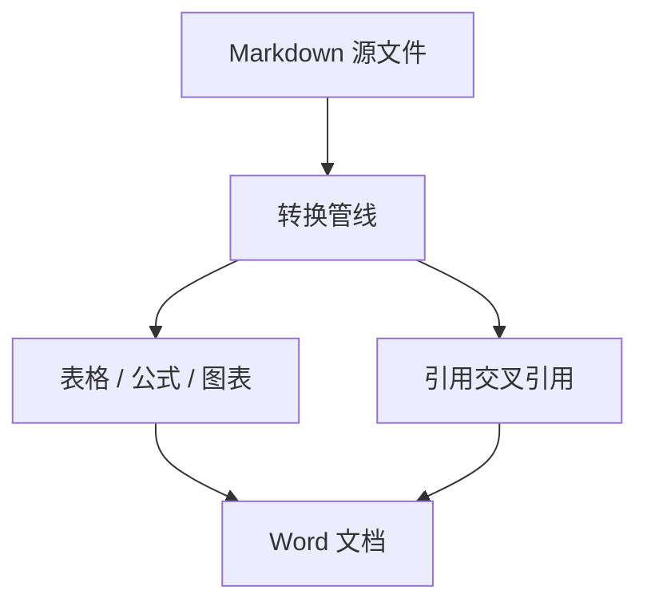

---
md2docx:
  toc: true
  toc_depth: 2
---

# Md2Docx 转换效果示例

本文档集中展示 Md2Docx 的转换能力：右侧为 Markdown 源码（`examples/demo.md`），生成的 `demo.docx` 由 CLI 一次转换产出。

## 表格

列宽按单元格内容智能分配，长文本列自动变宽；单元格内支持行内标签：

| 指标 | 数值 | 说明 |
|---|---|---|
| 转换引擎 | pandoc | 完全离线运行 |
| 表格 | 100% 满宽 | 等宽分隔行（`---`）会被识别为"无比例意图"，按内容重新分配列宽 |
| 公式 | OMML | Word 原生公式，可双击编辑 |

## 数学公式

质能方程 $E = mc^2$；多行对齐：

$$
\begin{aligned}
\nabla \cdot \mathbf{E} &= \frac{\rho}{\varepsilon_0} \
\nabla \cdot \mathbf{B} &= 0
\end{aligned}
$$

## 图表



```chart
{"type": "bar", "x": ["文本", "表格", "图表", "公式"], "series": [{"name": "示例", "data": [9, 8, 7, 8]}]}
```

## 参考文献交叉引用

引用角标会自动变成可点击的上标链接，例如本文的方法说明[1]、以及另一篇文献[2]。

## 参考文献

[1] Zhang S. Markdown to Word conversion with layout fidelity[J]. Software Tools, 2026, 12(3): 45-52.
[2] Li S. Offline document pipelines for Chinese technical reports[M]. Beijing: Publisher, 2025.
