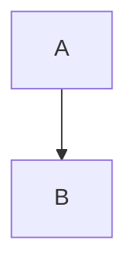

---
md2docx:
  toc: true
  reference_doc: 不存在的模板.docx
  unknown_key: x
---

# 体检测试

| 列A | 列B |
| --- | --- |
| <div>块级标签</div> | 正常 |

缺图片：

远程图：

公式编号：$$E=mc^2 \tag{1}$$



```mermaid
```

<table><tr><td colspan="2">原生表</td></tr></table>

```
围栏内的 | 竖线 和 <div> 不应报警
```
